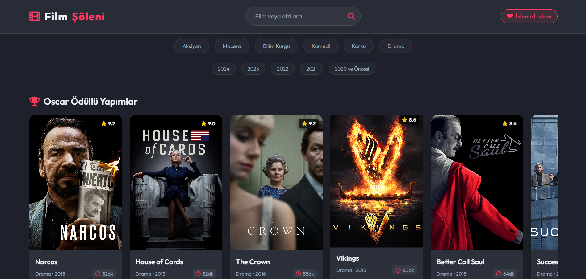
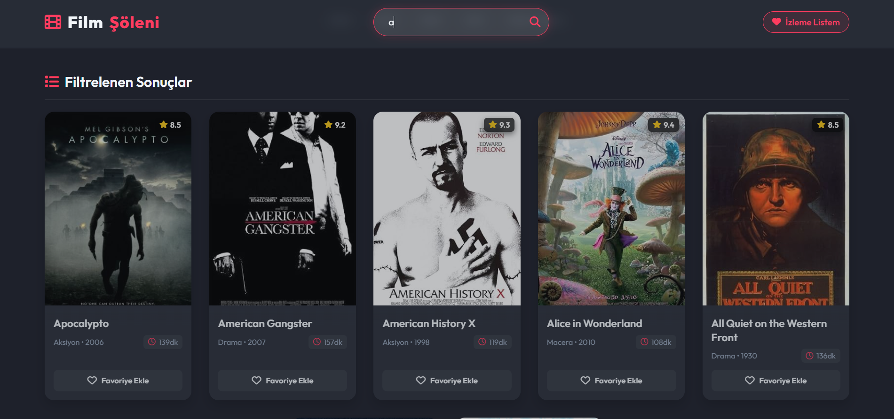
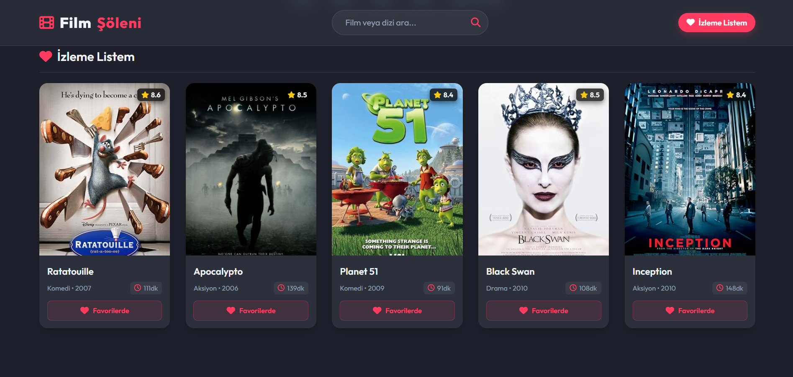
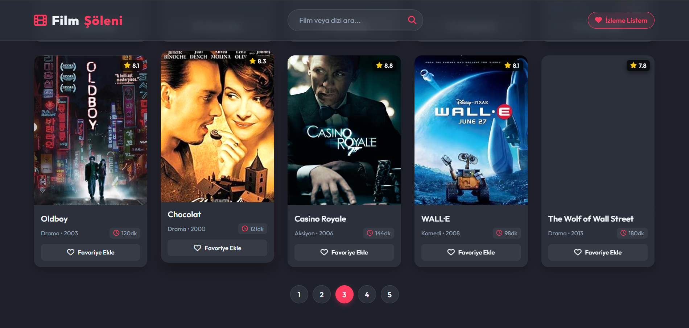

# Film Şöleni | Modern Sinema ve Dizi Portalı

Film Şöleni, kullanıcıların film ve dizileri keşfedebileceği, türlerine ve yıllarına göre filtreleyebileceği, arama yapabileceği ve kendi favori izleme listelerini oluşturabileceği modern ve interaktif bir web tabanlı sinema platformudur.

## Projenin Özellikleri

- Özel Bölümler: Oscar Ödüllü Yapımlar ve En Çok İzlenenler için ayrı yatay kaydırmalı vitrin alanları.
- Gelişmiş Filtreleme: Türlerine ve çıkış yıllarına göre dinamik filtreleme altyapısı.
- Anlık Arama: Kullanıcı dostu arama çubuğu ile isim bazlı hızlı film ve dizi arama.
- Kişiselleştirilmiş İzleme Listesi: LocalStorage entegrasyonu sayesinde kullanıcıların favori içeriklerini yönetebilmesi.
- Sayfalama: Büyük veri setlerini düzenli göstermek için dinamik sayfa yönetimi ve URL desteği.
- Duyarlı Tasarım: Modern cihazlara uyumlu, koyu tema odaklı şık arayüz.

## Kullanılan Teknolojiler

- HTML5 & CSS3
- JavaScript (ES6+)
- jQuery (v3.7.1)
- Font Awesome 6.4.0

## Ekran Görüntüleri

| Ana Sayfa | Arama Çubuğu |
| :---: | :---: |
|  |  |

| Favoriler | Sayfalar |
| :---: | :---: |
|  |  |

